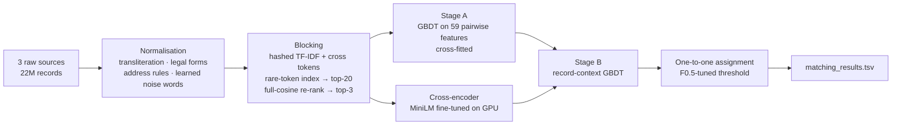

# Business Entity Resolution at Scale — Amazon ML Challenge 2026

**Team Quantum** · Suruthi H (lead), Giridharan H, Sherlin A

Resolving which business records refer to the same real-world business across **three noisy, independent sources**: 22 M records covering the US, India and France. There are no shared identifiers; records carry only a name, an address and a country.

| | |
|---|---|
| **Public leaderboard (macro F0.5)** | **0.978** |
| Held-out validation (macro F0.5) | 0.984 (precision 0.997, recall 0.956) |
| Candidates per reference entity | ~8 (97 % of true links retained) |
| Hardware | 4-core laptop (CPU pipeline) + one Kaggle T4 GPU (transformer step) |

---

## The problem

Source 1 is a deduplicated reference list. For every Source‑1 business, find all matching records in Sources 2 and 3 (zero, one or many). The data is deliberately noisy:

- **Names:** typos (`H0RIZON`, `Prmefum`), reordered words, legal-form variants (Pvt/Private, L.L.C., S.A.R.L.), honorifics, appended IDs and phone numbers, website-style names (`macillusionsprivate.com`), aliases (`X aka Y`, `X née Y`, `X doing business as Y`), and names written in **9 Indic scripts**.
- **Addresses:** abbreviations, missing or reordered components, injected PO boxes, `N°` numbering, city aliases (Bombay/Mumbai), French départements vs régions, and a house number that may carry a typo.
- **Look-alike "sibling" businesses:** the same name on the same street at a nearby house number, which may or may not be the same business.
- **France appears only in the test set** (no labels).

The metric is **macro F0.5 per Source‑1 entity**. Precision is weighted 2× recall, and unmatched ("singleton") entities count too.

## Approach



1. **Normalisation** (`textnorm.py`, `prep.py`)
   - Indic scripts are folded onto Devanagari and transliterated, and a lexicon learned from the training links maps them to English (`sistams → systems`).
   - Canonicalises legal forms, dotted acronyms and aliases.
   - Address rules for English, French and Indian formats.
   - An **unsupervised noise vocabulary**: words over-represented in Sources 2/3 relative to Source 1 are stripped.
2. **Blocking** (`blocking.py`)
   - Each record becomes a sparse TF‑IDF vector over hashed tokens: name words, name-word pairs, house number + street, and **name × address cross tokens**.
   - The cross tokens stay rare even when each part is common.
   - A rare-token inverted index (chunked sparse matrix products) retrieves the top 20 candidates, which are re-ranked by full cosine. It never forms the S1 × S2/S3 cross product.
3. **Stage A** (`features.py`, `match.py`)
   - Gradient-boosted trees on 59 features: fuzzy name/address similarities, character 3‑grams, **IDF-weighted name evidence** (rarest shared word, rarest missing word), typo-tolerant house-number comparison, and blocking context.
   - Cross-fitted on disjoint halves of the data.
4. **Cross-encoder** (`export_pairs.py`, `gpu_crossencoder.py`)
   - `cross-encoder/ms-marco-MiniLM-L-6-v2` (Apache‑2.0, 22 M parameters), fine-tuned on 2.4 M labelled candidate pairs.
   - It reads both records as text and resolves many cases string features cannot: AUC 0.79 vs 0.64 on the uncertain band.
5. **Stage B + assignment** (`combine_transformer.py`)
   - A small GBDT scores each pair relative to the other candidates of the same record.
   - Each Source‑2/3 record is assigned to at most one entity, with a threshold tuned for macro F0.5.
   - Records from country labels unseen in training (France) keep the stage‑A/B decision without the transformer; see *Lessons*.

## Results

| Version | Change | Validation F0.5 | Leaderboard |
|---|---|---|---|
| v1 | normalisation + blocking + GBDT | 0.973 | 0.964 |
| v2 | + entity-level "peer" context | 0.979 | 0.949 ↓ |
| v4 | peer context removed, shift-robust features | 0.974 | 0.966 |
| v5 | + IDF name evidence, 3‑grams, house-number similarity | 0.978 | 0.971 |
| **v7T** | **+ fine-tuned cross-encoder (US/India)** | **0.984** | **0.978** |

v5 and v7T were both checked on 4 disjoint entity holdouts and with a paired bootstrap before upload:

| Comparison | Gain on each of the 4 holdouts | Paired bootstrap, 95 % CI |
|---|---|---|
| v5 vs v4 | +0.38 to +0.42 | [+0.38, +0.43] |
| v7T vs v5 | +0.51 to +0.58 | [+0.52, +0.57] |

v5 was also run through a corruption test suite (house-number and name typos, reordering, removed words, missing addresses).

## Lessons learned

- **Validation gains don't always transfer.** v2's entity-level context gained +0.6 on validation but lost 1.7 on the leaderboard. Test has more look-alike siblings per entity, and features that depend on that density did not transfer. Checking feature distributions on unlabelled test inputs caught it.
- **Know when a model is out of its domain.** The cross-encoder never saw French. On France it was over-confident and would have re-added ~42 k sibling links, so records from unseen country labels fall back to the non-transformer decision.
- **Measure before building.** Diagnostics ruled out segment thresholds, margin rules, S2↔S3 triangulation and wider blocking before any upload was spent on them.

## Repository layout

```
src/
  config.py              paths (override via ER_DATA_ROOT / ER_WORK_DIR / ER_OUTPUT_DIR)
  textnorm.py, prep.py   normalisation, transliteration, lexicon, noise vocabulary
  blocking.py            candidate generation
  features.py, match.py  pairwise features, stage A/B, assignment, TSV writers
  run_all.py             end-to-end CPU pipeline (v5)
  export_pairs.py        export candidate pairs for the GPU step
  gpu_crossencoder.py    fine-tune + score the cross-encoder (GPU)
  combine_transformer.py final v7T submission
  evaluate.py, check_score.py, error_archetypes.py, segment_thresholds.py   analysis tools
docs/METHODOLOGY.md      full methodology write-up
```

## Reproducing

The challenge dataset is **not included** (competition data). Place it as `data/dataset/{train,test}/*.tsv`.

```bash
pip install -r requirements.txt
cd src
python run_all.py            # normalise → block → train → score (v5), ~4 h on 4 cores
python export_pairs.py       # pairs for the GPU step
# run gpu_crossencoder.py on a GPU (e.g. Kaggle T4, ~1.5 h); copy val/test_scores.parquet to work/gpu_score/
python combine_transformer.py   # final matching_results.tsv (v7T)
```

## License

MIT (see [LICENSE](LICENSE)). The dataset and pretrained model weights are not part of this repository.
